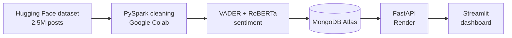

# Public Sentiment Analysis Using Big Data, Cloud and AI


An end-to-end big data, cloud and AI system that turns 300,000 social media posts into topic-level insights about public sentiment and shows them on a live dashboard.

**Live dashboard:** https://bigdata-sentiment-cloud-yz8luddtrzmyzxpqsgpapr.streamlit.app/
**API documentation:** https://sentiment-api-4o4f.onrender.com/docs

---

## Keywords & Topics

**Primary Keywords:** Sentiment Analysis · Natural Language Processing · Big Data · Cloud Computing · Public Opinion · Topic Analysis

**Technical Stack:** Python · PySpark · pandas · VADER · RoBERTa (Hugging Face Transformers) · MongoDB Atlas · FastAPI · Streamlit · Plotly · Google Colab · Render

**Business Focus:** Public Opinion Monitoring · Policy Insights · Social Media Analytics · Decision Support

---

## Problem Statement
Governments and organizations depend on slow, costly surveys to understand public opinion, while social media produces millions of opinions every day that are too large to read manually. This project processes a large collection of posts with PySpark, classifies each one with AI, groups the results by topic, and publishes them through a cloud database, a REST API and a public dashboard.

## Objectives
1. Process 300,000 social media posts using PySpark.
2. Label sentiment with VADER and validate it against a RoBERTa transformer model.
3. Analyze sentiment by topic (work/jobs, school, health, money).
4. Test the findings with a chi-square test.
5. Store the results in MongoDB Atlas.
6. Expose the data through a FastAPI REST API on Render.
7. Visualize the results on a Streamlit dashboard.
8. Document and publish the work.

---

## Project Plan



| Stage | Tool | Role |
|---|---|---|
| Dataset | Hugging Face | Public tweet sentiment data |
| Processing | PySpark on Google Colab | Cleaning 300,000 posts |
| AI | VADER, RoBERTa | Positive / neutral / negative labels |
| Storage | MongoDB Atlas | Cloud database for results |
| API | FastAPI on Render | Serves the results |
| Dashboard | Streamlit Community Cloud | Interactive charts |

---

## Features
- **Large-scale processing:** cleans 300,000 posts with PySpark (duplicates, links, mentions, symbols).
- **Two AI models:** VADER labels every post, and RoBERTa validates a 2,000-post sample (63.65% agreement).
- **Topic analysis:** work/jobs, school, health and money, assigned by keyword matching.
- **Statistical testing:** chi-square test with effect size (Cramer's V).
- **Cloud database:** results stored in MongoDB Atlas.
- **REST API:** `/overall`, `/topics` and `/posts` endpoints with automatic documentation.
- **Live dashboard:** pie chart, stacked bar chart by topic, and a post explorer.

---

## Screenshot
Screenshot of the live dashboard will be added here.

---

## Dataset
Public Hugging Face dataset `bdstar/Tweets-Sentiment-Analysis` (2,526,098 rows, 6 columns). A random sample of 300,000 posts was used.

| Topic | Keywords |
|---|---|
| Work/jobs | job, work, boss, unemployed, career, hired, fired |
| School | school, exam, homework, class, teacher, college |
| Health | sick, doctor, hospital, pain, flu, health |
| Money | money, pay, rent, broke, bills, price |

---

## Key Results

| Sentiment | Share of posts |
|---|---|
| Positive | 47.2% |
| Neutral | 27.6% |
| Negative | 25.2% |

| Topic | Posts | Positive | Neutral | Negative |
|---|---|---|---|---|
| Work/jobs | 12,962 | 43.3% | 28.9% | 27.8% |
| School | 6,555 | 40.6% | 30.6% | 28.8% |
| Health | 4,397 | 21.6% | 6.9% | 71.6% |
| Money | 3,004 | 44.0% | 13.2% | 42.7% |

- Health is the most negative topic (about 72% negative).
- Chi-square = 3236.3, 6 degrees of freedom, p < 0.001, Cramer's V = 0.25, so sentiment differs significantly between topics.

---

## Project Structure

```
.
├── sentiment_analysis.ipynb   # cleaning, sentiment labeling and analysis
├── main.py                    # FastAPI REST API
├── requirements.txt           # API dependencies
└── dashboard/
    ├── app.py                 # Streamlit dashboard
    └── requirements.txt       # dashboard dependencies
```

## API Endpoints

| Endpoint | Parameters | Returns |
|---|---|---|
| `/` | none | Status message |
| `/overall` | none | Overall sentiment counts |
| `/topics` | none | Sentiment counts per topic |
| `/posts` | `topic`, `limit` (default 20) | Sample posts, optionally filtered by topic |

---

## How to Run

1. Open `sentiment_analysis.ipynb` in Google Colab and set your own MongoDB connection string.
2. Deploy `main.py` on Render, with the build command and start command below, and add the connection string as the `MONGO_URI` environment variable.

```
pip install -r requirements.txt
uvicorn main:app --host 0.0.0.0 --port $PORT
```

3. Deploy `dashboard/app.py` on Streamlit Community Cloud.

To run the dashboard locally:

```
pip install -r dashboard/requirements.txt
streamlit run dashboard/app.py
```

---

## Limitations and Future Work
- No location data, so the analysis is by topic, not by region.
- Keyword topics can misclassify posts.
- VADER is rule-based and can misread sarcasm.
- Free hosting may take about 50 seconds to wake up.
- Future: regional sentiment map, automatic topic modeling, RoBERTa on all posts, live data collection.

## Security
The database connection string is stored only as an environment variable and is never committed to this repository.

## Author
Kanisha G
